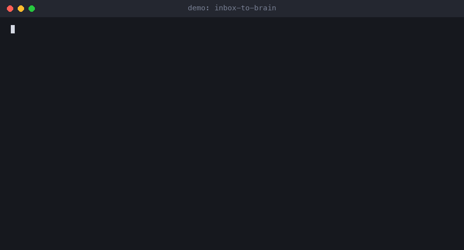

# inbox-to-brain

**Drop notes in an inbox. Your agent files them where they belong and flags the junk.**



[](tests)
[](#requirements)
[](#requirements)
[](#obsidian)
[](LICENSE)

Your coding agent learns things all day: a gotcha, a decision, a fact about the stack. Most of it disappears when the session ends. inbox-to-brain gives it one place to put those notes, and two small scripts that keep the place tidy.

- `router.py` reads each note's frontmatter and moves it to the right folder.
- `validator.py` reports notes that are too short, have no frontmatter, are only a todo list, or clash by name. It never moves anything.

It is plain markdown and plain Python, with no database. It works with Claude Code out of the box (slash commands included) and with any other agent that can run a shell command.

## Before and after

Before, one pile:

```text
my-vault/
├── 00_Inbox/
│   ├── 2026-10-01-0930-retry-with-backoff.md       type: decision, project: example-app
│   ├── 2026-10-02-1415-ios-simulator-clock.md      type: insight,  project: example-app
│   ├── 2026-10-03-1100-postgres-vacuum.md          type: knowledge, tag: databases
│   ├── 2026-10-03-1630-todo.md                     three checkboxes
│   ├── 2026-10-04-0900-quick-thought.md            "maybe use redis here?"
│   └── 2026-10-04-1000-mystery-project.md          project: billing-v2 (not in the config)
├── Projects/
└── Knowledge/
```

After `router.py --apply`:

```text
my-vault/
├── 00_Inbox/
│   ├── 2026-10-03-1630-todo.md                     stays: no frontmatter
│   ├── 2026-10-04-0900-quick-thought.md            stays: no frontmatter
│   ├── 2026-10-04-1000-mystery-project.md          stays: project 'billing-v2' is not in the config
│   └── _NEEDS_REVIEW.md                            written by validator.py
├── Projects/
│   └── example-app/
│       ├── example-app.md                          links to both new notes
│       ├── decisions/2026-10-01-0930-retry-with-backoff.md
│       └── knowledge/2026-10-02-1415-ios-simulator-clock.md
└── Knowledge/
    └── databases/2026-10-03-1100-postgres-vacuum.md
```

The router never guesses. A note with no type, no frontmatter or an unknown project stays in the inbox and the output says why.

## Try it

```bash
git clone https://github.com/nickspiz/inbox-to-brain && cd inbox-to-brain

cp -r starter-vault my-vault
cp examples/sample-inbox/*.md my-vault/00_Inbox/

python3 validator.py --vault my-vault      # writes my-vault/00_Inbox/_NEEDS_REVIEW.md
python3 router.py --vault my-vault         # dry run: shows what would move
python3 router.py --vault my-vault --apply # moves the files
```

The dry run looks like this:

```text
  would move  2026-10-01-0930-retry-with-backoff.md  ->  Projects/example-app/decisions/2026-10-01-0930-retry-with-backoff.md
  would move  2026-10-02-1415-ios-simulator-clock.md  ->  Projects/example-app/knowledge/2026-10-02-1415-ios-simulator-clock.md
  would move  2026-10-03-1100-postgres-vacuum.md  ->  Knowledge/databases/2026-10-03-1100-postgres-vacuum.md
  stays   2026-10-03-1630-todo.md  (no frontmatter, so I cannot tell what this is)
  stays   2026-10-04-0900-quick-thought.md  (no frontmatter, so I cannot tell what this is)
  stays   2026-10-04-1000-mystery-project.md  (project 'billing-v2' is not in the config)

would move 3, staying in the inbox 3.  Dry run. Add --apply to do it.
```

And the validator report:

```text
| Note | Flag | Why |
|---|---|---|
| [[2026-10-03-1630-todo]] | too-short | 54 characters, the minimum is 200 |
| [[2026-10-03-1630-todo]] | no-frontmatter | the note starts without a --- block |
| [[2026-10-03-1630-todo]] | todo-only | 3 checkbox lines and no prose |
| [[2026-10-04-0900-quick-thought]] | too-short | 21 characters, the minimum is 200 |
| [[2026-10-04-0900-quick-thought]] | no-frontmatter | the note starts without a --- block |
```

## Install as a Claude Code plugin

```text
/plugin install inbox-to-brain --marketplace nickspiz/inbox-to-brain
```

This adds `/inbox-to-brain:inbox-route` and `/inbox-to-brain:validate-inbox`, and the scripts come with it. You still need an `inbox-to-brain.toml` in your vault root (see below).

## Use it in your own vault

1. Copy `router.py`, `validator.py` and `notes.py` into your vault (or anywhere, and pass `--vault`).
2. Copy `starter-vault/inbox-to-brain.toml` into the vault root and list your projects.
3. Copy `starter-vault/_templates/` if you want note templates.
4. Paste `CLAUDE-snippet.md` into your `CLAUDE.md` (or the equivalent file for your agent). It tells the agent to write a short note into the inbox after any non-trivial task.
5. Copy `.claude/commands/` into your project so `/inbox-route` and `/validate-inbox` work in Claude Code.

## How a note gets routed

| Frontmatter | Goes to |
|---|---|
| `type: decision` and a known project | `Projects/<slug>/decisions/` |
| `type: insight` or `knowledge` and a known project | `Projects/<slug>/knowledge/` |
| a type, no project | `Knowledge/<first topic tag>/`, or `Knowledge/_general/` |
| a project that is not in the config | stays in the inbox |
| no frontmatter, or no type | stays in the inbox |

The project is read from `project: <slug>` or from a `project/<slug>` tag. The type is read from `type:` or, if that is missing, from a `decision`, `insight` or `knowledge` tag. The topic folder is the first tag that is not a type and not a project tag.

After a move, the router adds `- [[note-name]]` under `## Decisions` or `## Knowledge` in `Projects/<slug>/<slug>.md`, if that page exists. It never overwrites a note that is already in the destination.

## Configure

`inbox-to-brain.toml` in the vault root (or `inbox-to-brain.json`; JSON is the only option on Python older than 3.11):

```toml
projects = ["example-app", "billing"]   # the only projects the router will file under

[aliases]
app = "example-app"                      # other names for the same project

min_chars = 200                          # shorter notes are flagged

[folders]                                # rename if you like
inbox = "00_Inbox"
projects = "Projects"
knowledge = "Knowledge"
```

No project names are built into the scripts. With no config file, every note that names a project stays in the inbox.

## Obsidian

Open `my-vault` as a vault. Notes are plain markdown with YAML frontmatter, links are `[[wikilinks]]`, and the report links each flagged note so you can click through. The scripts do not need Obsidian.

## Use it with other agents

The scripts are ordinary command-line tools, so any agent that can run a shell command can use them. Tell it to run `python3 validator.py --vault .` and then `python3 router.py --vault .`, and to run again with `--apply` only after you approve the list.

## Requirements

Python 3.9 or newer. No packages. TOML config needs Python 3.11+; older versions use JSON.

## Tests

```bash
pip install pytest
pytest
```

The tests build a temporary vault from `starter-vault/` and never touch your own files.

## FAQ

**Can the router delete a note?**
No. It moves files, and only with `--apply`. The validator only writes `_NEEDS_REVIEW.md`.

**What if two notes have the same name?**
The router leaves the inbox copy where it is and says so. The validator flags the clash.

**Do I have to use the templates?**
No. Any note with `type:` and either `project:` or a `project/<slug>` tag will route.

**Can the agent run the router by itself?**
It can, but the shipped commands do a dry run first and ask before moving anything. Keep that order unless you trust your config.

## License

MIT

If this helped, a star helps others find it.
